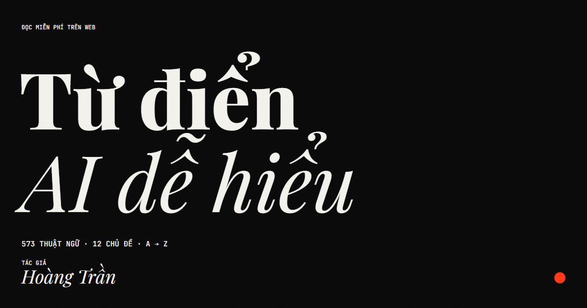

# Từ điển AI dễ hiểu — website



573 thuật ngữ AI giải thích bằng tiếng Việt đơn giản. Đọc theo chủ đề như đọc một cuốn sách, hoặc tra A → Z khi cần.
Tác giả: **Hoàng Trần**. Bản 0.1, mốc nội dung tháng 10/2026.

Website là **file tĩnh thuần** (HTML, CSS, JavaScript), không có framework và không cần bước build.
Tải thư mục này lên GitHub, bật GitHub Pages là chạy.

---

## Đưa lên GitHub Pages (khoảng 5 phút)

### Cách 1 — Kéo thả trên trang GitHub (không cần cài gì)

1. Vào <https://github.com/new>, đặt tên repository, ví dụ `tu-dien-ai`, chọn **Public**, bấm **Create repository**.
2. Ở trang repository mới, bấm **uploading an existing file**.
3. Mở thư mục `tu-dien-ai-web` trên máy, chọn **toàn bộ nội dung bên trong** (không chọn chính thư mục),
   rồi kéo thả vào trang GitHub. File `index.html` phải nằm ở gốc repository.
4. Bấm **Commit changes**.
5. Vào **Settings → Pages**. Ở mục *Build and deployment*, chọn **Source: Deploy from a branch**,
   **Branch: `main`**, thư mục **`/ (root)`**, rồi bấm **Save**.
6. Chờ 1–2 phút. Website có địa chỉ `https://<tên-tài-khoản>.github.io/tu-dien-ai/`.

> **Quan trọng:** kiểm tra file `.nojekyll` đã lên repository. File này rỗng nhưng bắt buộc: nó tắt Jekyll,
> để GitHub phục vụ nguyên trạng các file `.md` và `_*.csv` trong `content/`.
> Windows và macOS có thể ẩn file bắt đầu bằng dấu chấm. Nếu thiếu, trên GitHub bấm
> **Add file → Create new file**, đặt tên `.nojekyll`, để trống nội dung, rồi **Commit**.

### Cách 2 — Dòng lệnh git

```bash
cd tu-dien-ai-web
git init -b main
git add .
git commit -m "Website Từ điển AI dễ hiểu"
git remote add origin https://github.com/<tên-tài-khoản>/tu-dien-ai.git
git push -u origin main
```

Sau đó bật Pages như bước 5 ở trên.

### Sau khi website chạy

Mạng xã hội cần đường dẫn đầy đủ cho ảnh xem trước. Mở `index.html`, sửa dòng

```html
<meta property="og:image" content="assets/img/og.png">
```

thành `https://<tên-tài-khoản>.github.io/tu-dien-ai/assets/img/og.png`.

---

## Xem thử trên máy

Mở thư mục bằng một máy chủ tĩnh bất kỳ, ví dụ:

```bash
python -m http.server 8000
```

rồi vào <http://localhost:8000>. Dữ liệu được nạp bằng thẻ `<script>` (không dùng `fetch`),
nên website cũng được thiết kế để mở thẳng `index.html` bằng trình duyệt.
Phông chữ tải từ Google Fonts, nên cần mạng để hiển thị đúng kiểu chữ.

---

## Tính năng

| Trang | Đường dẫn | Nội dung |
|---|---|---|
| Trang chủ | `#/` | Hero kiểu tạp chí, video giới thiệu viết bằng code, số liệu, từ của ngày, 74 từ cốt lõi (cuộn ngang), cặp dễ nhầm, lộ trình |
| Chủ đề | `#/chu-de` | 12 chương như 12 "số tạp chí", bìa vẽ bằng code, tiến độ đọc |
| Đọc chương | `#/chu-de/04` | Đọc liền mạch cả chương, mục lục bám theo, lọc Mức 1 / 1–2 / tất cả, tự đánh dấu mục đã đọc |
| Mục từ | `#/t/rag` | Trang riêng mỗi thuật ngữ, bản đồ liên quan, "dễ nhầm với", "nên đọc trước", phím ← → để đi tiếp |
| A → Z | `#/a-z` | Chỉ mục Anh → Việt và Việt → Anh (có tên khác), lọc theo mức, chương, trạng thái |
| Lộ trình | `#/lo-trinh` | 3 lộ trình của Chương 0, có tiến độ và nút "Đọc tiếp" |
| Dễ nhầm | `#/de-nham` | 463 cặp thuật ngữ, lọc nhanh |
| Tên riêng | `#/ten-rieng` | Phụ lục 90: 59 tên theo 9 lớp |
| Dòng thời gian | `#/dong-thoi-gian` | Phụ lục 91: 70 mốc 2012–2026 |
| Viết tắt | `#/viet-tat` | Phụ lục 92 |
| Học | `#/hoc` | Thẻ ghi nhớ lật 2 mặt và trắc nghiệm 4 lựa chọn, theo chương hoặc mức |
| Studio video | `#/studio/rag` | Biến bất kỳ thuật ngữ nào thành video 9:16, 1:1 hoặc 16:9, xuất MP4 |
| Tác giả | `#/tac-gia` | Hoàng Trần và hậu trường làm sách |
| Cách đọc | `#/cach-doc` | Chương 0 |
| Đã lưu | `#/da-luu` | Mục đã lưu, xem gần đây, tiến độ theo chương |

Khắp website:

- **Tìm kiếm** bằng phím `/` hoặc `Ctrl K`. Gõ có dấu hay không dấu đều ra ("ao giac" → Ảo giác).
  Bật "Tìm cả trong nội dung" để tìm trong toàn văn.
- **Xem nhanh**: rê chuột lên một liên kết thuật ngữ để đọc định nghĩa mà không rời trang.
- **Nền sáng / tối**, đổi **cỡ chữ**, **tắt chuyển động** (website cũng tôn trọng cài đặt "giảm chuyển động" của máy).
- Tiến độ đọc, mục đã lưu, thẻ đã thuộc được lưu **trên trình duyệt của người đọc** (localStorage), không gửi đi đâu.

---

## Thủ thuật: video viết bằng code

Cộng đồng đang dùng Claude Code để "code ra video":
[Remotion](https://www.remotion.dev/docs/ai/claude-code-plugin) biến video thành component React,
[HyperFrames](https://hyperframes.heygen.com/) (mã nguồn mở của HeyGen) biến trang HTML thành MP4.
Bí quyết chung: **mỗi khung hình là một hàm của thời gian**. Muốn khung hình ở giây `t` thì gọi `seek(t)`.

Website áp dụng đúng nguyên lý đó ngay trong trình duyệt, ở `assets/js/film.js`:

- Mỗi video là một chuỗi cảnh. Mỗi cảnh có hàm `draw(ctx, t)` vẽ lên canvas.
  Hàm `interpolate()` và các hàm easing giống cách Remotion mô tả chuyển động.
- **Xem trước**: trình phát gọi `draw(t)` ở mỗi khung hình của trình duyệt.
- **Xuất MP4**: dựng lần lượt từng khung hình, mã hóa H.264 bằng WebCodecs, đóng gói bằng
  [mp4-muxer](https://github.com/Vanilagy/mp4-muxer) (đã kèm sẵn trong `assets/vendor/`, giấy phép MIT).
  Video 20 giây dựng xong trong khoảng 10–20 giây. Trình duyệt không có WebCodecs sẽ ghi WebM theo thời gian thực.
- Ảnh xem trước `assets/img/og.png` cũng được "chụp" từ chính video giới thiệu.

Muốn làm video phức tạp hơn (nhạc, giọng đọc, 3D) bằng Claude Code, cài plugin Remotion:

```bash
claude plugin marketplace add remotion-dev/claude-code-plugin
```

```bash
claude plugin install remotion@remotion
```

Remotion cần Node.js; xem điều khoản giấy phép của Remotion trước khi dùng cho tổ chức.

---

## Cập nhật nội dung sách

Nội dung gốc nằm trong `content/` (các chương `.md`, phụ lục, `_terms.csv`, `_sources.csv`, `_vocab.csv`, `BOOK.md`).
Khi sách có bản mới:

1. Chép các file `.md` và `.csv` mới vào `content/` (giữ nguyên tên file).
2. Chạy (cần Python 3, không cần cài thêm thư viện):

   ```bash
   python tools/build.py
   ```

3. Script in số mục, số cụm và số liên kết hỏng. Nếu "Liên kết hỏng: 0" thì đẩy lên GitHub.

`tools/build.py` sinh lại `data/index.js`, `data/ch/NN.js`, `data/extra.js`, `data/fulltext.js`.
Số liệu trên website (573 mục, 740 nguồn, 463 cặp…) đều tính từ dữ liệu, nên tự cập nhật theo.

---

## Cấu trúc thư mục

```
tu-dien-ai-web/
├── index.html            khung trang, header, footer, bảng tìm kiếm
├── 404.html              chuyển đường dẫn lạ về trang chủ
├── .nojekyll             tắt Jekyll trên GitHub Pages (bắt buộc)
├── favicon.svg
├── assets/
│   ├── css/style.css     giao diện đen–trắng, chuyển động, giao diện điện thoại
│   ├── js/app.js         định tuyến, các trang, tìm kiếm tiếng Việt, hiệu ứng
│   ├── js/film.js        engine "video viết bằng code" và xuất MP4
│   ├── img/og.png        ảnh xem trước khi chia sẻ
│   └── vendor/           mp4-muxer (MIT)
├── data/                 dữ liệu sinh từ content/ — không sửa tay
├── content/              bản gốc của sách (Markdown, CSV)
└── tools/build.py        content/ → data/
```

---

## Ghi chú

- Nội dung từ điển là thông tin chung về thuật ngữ, không phải tư vấn pháp lý (xem Chương 0, mục 0.8).
- Website dùng định tuyến bằng dấu `#`, nên không cần cấu hình máy chủ và mọi liên kết đều chia sẻ được.
- Chưa chọn giấy phép cho nội dung sách. Nếu muốn người khác dùng lại, thêm file `LICENSE`
  (ví dụ CC BY 4.0 cho nội dung) trước khi công khai.

Làm bằng Claude Code.
